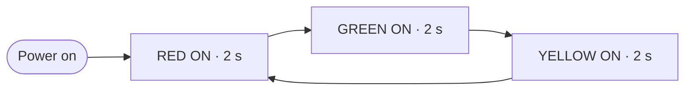

# Traffic Light Control System

An Arduino-based automated traffic light controller. Red, yellow and green LEDs switch in a fixed sequence, the way a single road signal works.

**Institute:** Government Polytechnic, Solapur · **Branch:** Electronics & Telecommunication Engineering

---

## 📌 Overview

The project uses an **Arduino Uno** to control one traffic signal made of three LEDs (red, yellow, green). Each light stays on for **2 seconds** and the cycle repeats automatically, with no manual control.

## ✨ Features

- Single traffic signal with red, yellow and green LEDs
- Fixed sequence, repeating automatically
- 2 seconds per light
- Simple, low-cost build that is easy to extend

## 🧰 Components

| Component | Quantity |
|---|---|
| Arduino Uno | 1 |
| LED (red) | 1 |
| LED (yellow) | 1 |
| LED (green) | 1 |
| Current-limiting resistors (typically 220 Ω) | 3 |
| Breadboard and jumper wires | as needed |

## 🔌 Circuit Connections

The sample code uses these pins. If your wiring is different, change the pin numbers at the top of the sketch.

| LED | Arduino pin | Connection |
|---|---|---|
| Red | D8 | Pin → resistor → LED anode (+), LED cathode (−) → GND |
| Yellow | D9 | Pin → resistor → LED anode (+), LED cathode (−) → GND |
| Green | D10 | Pin → resistor → LED anode (+), LED cathode (−) → GND |

## ⚙️ How It Works

1. The Arduino sets the three LED pins as outputs.
2. In a loop, it turns on one light, keeps the other two off, and waits 2 seconds.
3. It moves to the next light in the sequence: red → green → yellow → red.

## 💻 Code

Sketch: [`code/traffic_light/traffic_light.ino`](code/traffic_light/traffic_light.ino)

To run it:
1. Open the sketch in the Arduino IDE.
2. Select **Board: Arduino Uno** and the correct port.
3. Click **Upload**.

> The sketch in this repository is a clean reference version of the sequence described above. Adjust the pins to match your circuit.

## 🔮 Possible Improvements

- Four-way junction with two signal sets
- Pedestrian push button
- Countdown display
- Adjustable timing with a potentiometer

## 👩‍💻 Author

**Munazza Hawaldar**
E&TC Diploma, Government Polytechnic, Solapur (2026)
[LinkedIn](https://www.linkedin.com/in/munazza-hawaldar-644b0041a/) · [Portfolio](https://sites.google.com/view/munazzahawaldar-portfolio/home)
