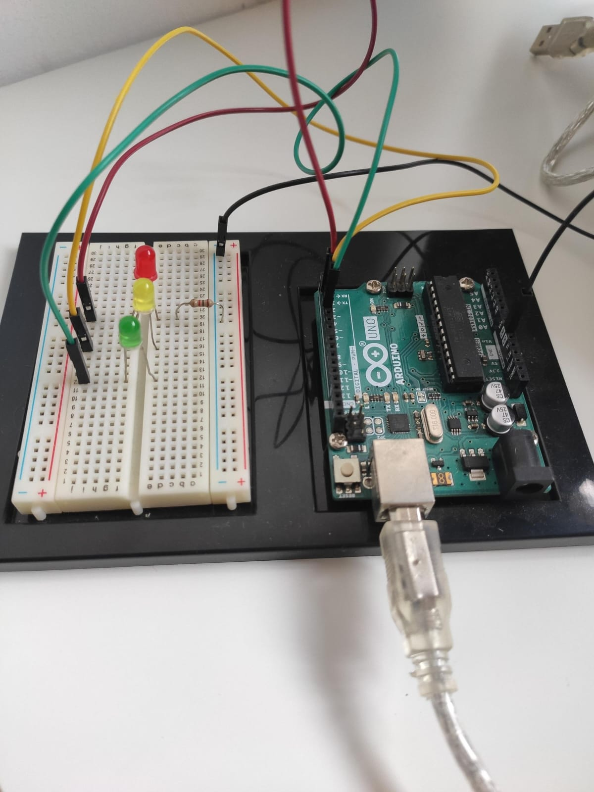

# Traffic Light Control System


An Arduino Uno based traffic signal that cycles through red, green and yellow lights automatically, 2 seconds each.

<p align="center">
  
  <br/><i>The working circuit: Arduino Uno, breadboard and three LEDs</i>
</p>

---

## 📌 Overview

This project simulates a single traffic signal. The Arduino switches three LEDs on and off in a fixed sequence, so each light stays on for 2 seconds before the next one turns on. It is a basic example of digital output control and timing on a microcontroller.

## ✨ Features

- Automatic red → green → yellow sequence that repeats continuously
- 2 seconds for each light
- Simple code that is easy to change (timing and pins are set at the top of the sketch)

## 🧰 Components

| Component | Quantity |
|---|---|
| Arduino Uno | 1 |
| Red LED | 1 |
| Yellow LED | 1 |
| Green LED | 1 |
| Resistor (for the LEDs) | as used on the breadboard |
| Breadboard | 1 |
| Jumper wires | as needed |
| USB cable (power and programming) | 1 |

## 🔌 Connections

| LED | Arduino pin |
|---|---|
| Red | D2 |
| Yellow | D3 |
| Green | D4 |
| LED cathodes (short leg) | GND, through a resistor |

If your wiring uses different pins, change `RED_PIN`, `YELLOW_PIN` and `GREEN_PIN` at the top of the sketch.

## ⚙️ How It Works

1. The Arduino sets pins D2, D3 and D4 as outputs.
2. Red turns on for 2 seconds, with the other two LEDs off.
3. Green turns on for 2 seconds.
4. Yellow turns on for 2 seconds.
5. The cycle repeats forever.


## 🚀 How to Run

1. Build the circuit as in the photo and the connection table above.
2. Open `code/traffic_light/traffic_light.ino` in the Arduino IDE.
3. Select **Tools → Board → Arduino Uno** and the correct port.
4. Click **Upload**. The lights start cycling.

## 📁 Project Structure

```
Traffic-Light-Control-System/
├── code/
│   └── traffic_light/
│       └── traffic_light.ino
├── images/
│   └── circuit.jpg
└── README.md
```

## 🔮 Possible Improvements

- Add a pedestrian push button
- Build a four-way junction with 12 LEDs
- Use a timer interrupt instead of `delay()`
- Add a countdown display

## 👩‍💻 Author

**Munazza Hawaldar**
E&TC Diploma, Government Polytechnic, Solapur (2026)
[LinkedIn](https://www.linkedin.com/in/munazza-hawaldar-644b0041a/) · [Portfolio](https://sites.google.com/view/munazzahawaldar-portfolio/home)
